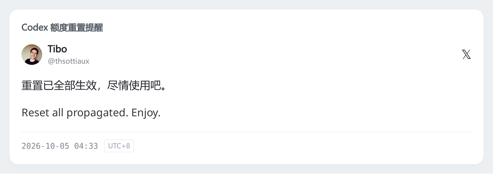
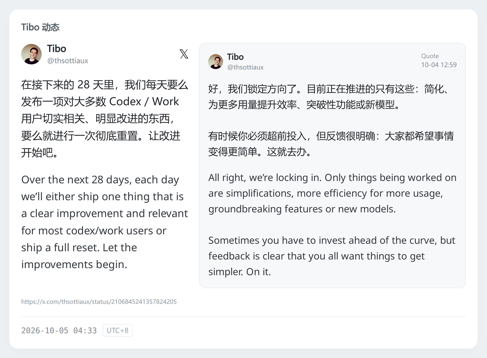
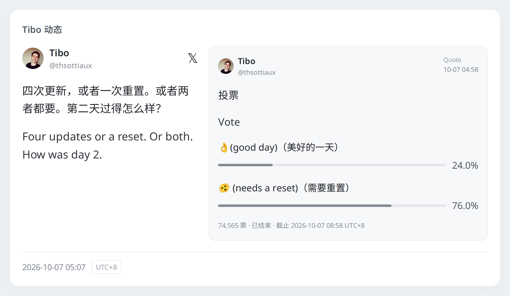
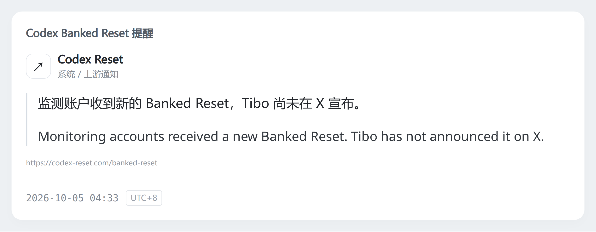

# Codex Reset Watcher（Codex 额度重置提醒）

这是一个 MaiBot 插件：它会替你盯着 Codex 额度重置、Banked Reset 和 Tibo 的相关动态，有重要消息时自动翻译成中文，发到你指定的 QQ 群。

装好之后不用一直刷 X（Twitter）或盯着上游页面。插件在后台定期检查公开数据：没有新消息时保持安静，出现值得提醒的动态时才会说话。

- 自动监控，有新消息才发，不打扰；
- 自动翻译成中文，原文一并保留；
- 支持简洁美观的图片卡片，也可以用纯文字；
- 支持同时通知多个 QQ 群；
- 不需要 OpenAI API Key，也不需要 X（Twitter）API Key；
- 不登录你的 OpenAI / Codex 账号。

当前版本：**0.2.0** · 许可证：[MIT](LICENSE) · 运行环境：MaiBot Host `1.2.2 – 1.3.5`、SDK `2.8.0 – 2.10.0`

## 它能帮你做什么

| 场景 | 你会收到什么 |
| --- | --- |
| Codex 全局额度重置 | 上游确认值得告警的重置消息，以及后续确认生效的消息 |
| Banked Reset | 上游推送的 Banked 动态。注意：这不等于你的额度已经刷新，见[后文说明](#banked-reset-是什么) |
| 重置相关告警 | 数据源面向用户发布的其它 Codex 重置相关告警 |
| Tibo 动态（可选） | 开启「Tibo 全推送」后，Tibo 的普通发帖、长帖、带自己评论的引用帖等日常动态也会同步到群里 |

每条提醒都会尽量带上中文翻译。翻译由 MaiBot 已经配置好的大模型完成，不需要你申请或配置任何额外服务。翻译失败时提醒照常发送，只是少一段中文。

## 通知长什么样

开启图片模式后，通知会长这样：

<table>
  <tr>
    <td width="50%" align="center">
      
      <br /><b>普通 Tibo 动态</b>
      <br /><sub>中文译文在上，英文原文在下，附带北京时间</sub>
    </td>
    <td width="50%" align="center">
      
      <br /><b>引用动态</b>
      <br /><sub>主帖和被引用的帖子并排展示，都有中文翻译</sub>
    </td>
  </tr>
  <tr>
    <td width="50%" align="center">
      
      <br /><b>带投票的引用动态</b>
      <br /><sub>投票选项、百分比、比例条和总票数直接看图</sub>
    </td>
    <td width="50%" align="center">
      
      <br /><b>系统 / 上游通知</b>
      <br /><sub>没有推文的系统事件，也有独立清晰的样式</sub>
    </td>
  </tr>
</table>

几点说明：

- 以上是项目当前的卡片效果预览（使用演示正文或明确标注的真实投票快照），不是新的真实 QQ 投递截图；
- 实际显示内容会随消息变化，例如有没有引用、有没有投票、是不是系统事件；
- 图片渲染或发送失败时，会自动回退成纯文字通知，提醒内容不受影响。

## 三分钟开始使用

### 方式一：MaiBot 插件市场（推荐）

插件已提交到 MaiBot 插件市场收录审核，收录完成后可以直接在市场搜索 **Codex 额度重置提醒** 安装。如果市场里暂时还看不到 0.2.0 版本，请先用下面的手动安装方式，安装内容完全一样。

### 方式二：手动安装

1. 下载或克隆本仓库；
2. 把整个仓库目录放进 MaiBot 的 `plugins/` 插件目录（也可以直接在插件目录里 clone 本仓库）；
3. 让 MaiBot 加载并启用插件。

### 装好之后

1. 打开插件的 WebUI 配置页；
2. 在 `group_ids` 里填写要接收提醒的 QQ 群号；
3. 保存配置。

**到这里基础功能就已经可以用了**——插件会开始检查重置相关消息，并以文字形式发到群里。

两个可选开关（同样在 WebUI 里就能改，不必手改配置文件）：

- 想要上面的卡片效果 → 把 `display_mode` 设为 `image`；
- 想额外同步 Tibo 的日常动态 → 打开 `tibo_full_push`。

## 需要准备什么

- 一个正在运行的 MaiBot；
- 一个用来接收消息的 QQ 群；
- 没了。

再强调一遍：

- 不需要 OpenAI API Key，不需要 X（Twitter）API Key；
- 插件只读取公开数据：不登录你的 OpenAI / Codex 账号，不读取你的额度，也不会替你执行任何重置操作；
- 中文翻译直接使用 MaiBot 已配置的大模型，无需额外配置。

## 常用设置

大多数用户直接在 MaiBot WebUI 里配置即可，不需要手动编辑配置文件。

| 设置 | 它管什么 | 建议 |
| --- | --- | --- |
| 接收群 `group_ids` | 提醒发到哪些 QQ 群 | 填自己的群号 |
| 检查间隔 `check_interval` | 多久检查一次新消息，默认 240 秒（4 分钟） | 默认即可 |
| 通知样式 `display_mode` | `text` 纯文字 / `image` 图片卡片 | 喜欢卡片选 `image` |
| Tibo 全推送 `tibo_full_push` | 是否额外同步 Tibo 的日常动态 | 默认关闭，想要时再开 |
| 中文翻译 `llm.enabled` | 是否自动翻译成中文 | 默认开启 |

对应的配置文件片段（仅供参考，平时用 WebUI 就好）：

```toml
[watcher]
group_ids = []            # 接收提醒的 QQ 群，例如 ["100000001"]
check_interval = 240      # 检查间隔（秒），默认 240
tibo_full_push = false    # Tibo 动态全推送，默认关闭
display_mode = "text"     # text / image，图片失败自动回退文字
timezone = "Asia/Shanghai"

[llm]
enabled = true            # 是否启用中文翻译
model_task = "replyer"    # WebUI 推荐选择：replyer / planner / utils
```

完整默认配置见 [config.example.toml](config.example.toml)。实际的 `config.toml` 由 MaiBot 在运行时生成和维护，不需要手动放置。配置结构版本为 **1.3.0**，与插件版本分开管理；升级插件不会清空你已填写的配置和发送记录。

## 更多功能

### 中文翻译

开启翻译后，插件会复用 MaiBot 已有的大模型能力，把 Tibo 原文完整翻译成简体中文。

- 不总结、不压缩、不删减；
- 歌词、玩笑、寒暄、重复内容也会正常翻译；
- 能可靠确定的时间会换算成北京时间；
- 翻译失败或超时，只会少一段中文翻译，不会阻止提醒发送；
- 拿不到可靠原文时，插件不会拿摘要冒充原文；文字模式保留标题和原帖链接，方便自行核对。

不想使用翻译时，在 WebUI 关闭 `llm.enabled` 即可。翻译通过 Host 的 `llm.generate` 能力完成并沿用其模型任务解析，兼容 SDK 2.8.1。

### Tibo 全推送（可选）

`tibo_full_push = true` 会新增一条独立的动态车道，从公开 feed 的 Tibo timeline 推送：

- 普通发帖；
- 长帖；
- 带自己评论的引用帖；
- 明确回复自己的续帖（讨论串会连起来）。

以下内容保守排除，不推送：

- 回复别人的帖子；
- 回复对象不明确的帖子；
- 纯转发；
- 只有链接的分享。

首次开启或新加群时，插件会静默记录当前已有动态作为基线，之后只推送新出现的动态；超过 48 小时年龄护栏的历史动态不补发；缺失必要元数据的动态等待后续补齐。投递顺序的细节见 [Tibo 投递顺序说明](docs/tibo-ordering.md)。

### 多个 QQ 群

可以同时配置多个群。每个群独立发送、独立记录、独立重试：一个群发送失败不会影响其它群。

同一条已经成功发送的告警不会在同一群里反复发送；如果上游把同一件事分成「宣布」「确认生效」等不同阶段分别告警，插件也会按上游实际告警分别提醒。

### 文字通知的结构

文字通知（包括图片失败后的文字回退）通常包含三段：**中文翻译 → Tibo 原文（或原文摘录）→ 原帖链接**。

监测账户产生的系统事件可能没有对应推文。这类通知展示「上游通知」正文与「来源」页面，不会把事件 ID 冒充成推文 ID。

## 可靠性与已知限制

### 基本原则

上游决定什么值得告警，插件负责把已经成立的告警可靠地镜像到 QQ，不会根据推文文本自己猜「这条到底该不该发」。

发送状态按 QQ 群分别保存（内部叫 receipt，即发送记录）：某个群发送失败时，下次会继续重试；已经成功的群不会因此重复发送。插件会利用发送记录和上游覆盖信息避免同一动态在同一群里重复出现；没有可靠关联时保守发送。

### Banked Reset 是什么

Banked Reset 不是「当前额度立刻刷新」。

它更接近「把一次重置机会存进账户，之后再由你使用」。因此看到 Banked Reset 提醒时，不要把它理解成当前 Codex 额度已经自动恢复。

插件只负责把上游发布的 Banked 动态及时转发到 QQ，不会替你兑换或使用 Banked Reset。

### 需要诚实说明的上游限制

部分 Banked 推送接口只提供「当前最新一条」，没有完整历史记录或游标。

因此，如果插件停机，或者两次检查之间某条 Banked 推送很快又被下一条推送覆盖，那么已经消失的那条消息可能无法找回。插件覆盖的是检查时仍然可见的上游 Banked 推送，不承诺离线恢复或被覆盖后的补偿。

这不是通过增加本地关键词判断就能可靠解决的问题；完整离线恢复需要上游提供带历史记录或游标的告警接口。

## 图片通知的实现细节

`display_mode = "image"` 会把所有活跃车道切换为图片通知。图片使用仓库内置的 HTML / CSS 模板，经 MaiBot Host 的 `render.html2png` 本地浏览器截图，再通过 `send.image` 发送。一条管线的图片由各群共享；生成失败、超时、结果无效或某群发图失败，只向该群回退文字。成功发图不追加文字；文字回退成功后同样记录正常发送记录，不再补图。文字和图片都失败则不记录，下一轮独立重试。

卡片样式的具体行为：

- Tweet 模板：保留通知标题，显示 Tibo 头像、名称和 `@thsottiaux`，完整中文译文在英文原文之上，时间使用 `YYYY-MM-DD HH:MM` 与 `UTC+8` 标签。
- 系统模板：明确显示「系统 / 上游通知」，不显示 Tibo 账号或头像；无发布时间时使用本次生成时间。
- 引用帖：有引用正文或结构化投票才显示独立引用区；引用也整块翻译，译文在原文之上；引用正文缺失时完全隐藏引用区。
- 引用投票：选项展示原文及括号内中文译文、比例条、一位小数百分比、总票数与可靠的截止状态。这是生成通知时的快照；未取得可靠截止信息时如实显示状态未知，不推测 viewer 的选择。真实 schema 与边界见[引用投票说明](docs/quoted-poll.md)。
- 图片不单独展示来源 URL；正文和译文中本来存在的网址正常保留。文字模式及文字回退继续保留原帖链接。
- 中英文字体使用本地打包的 Noto Sans SC / Noto Sans WOFF2 子集，统一 CSS 字族，无需 CDN；字体许可与构建方法见[字体归属说明](templates/assets/ATTRIBUTION.md)。

环境说明：Host 管理 Playwright、Chromium 与系统库，插件不新增浏览器或 Python 依赖。首次浏览器下载可能较慢，建议先准备好 Host 渲染环境；渲染关闭、缺包、缺浏览器、下载/RPC/截图或发图失败时按群回退文字。注意：manifest 或版本校验拒绝加载发生在插件运行之前，此时无法执行文字回退。完整准备方法与降级合同见[图片通知说明](docs/image-notifications.md)。

## 常见问题

**重启 MaiBot 后会重复发以前的消息吗？**
正常不会。插件会把已经成功发送的通知记录保存在 MaiBot 数据目录的 `reset_state.json` 中，重启后继续按记录去重。

**离线期间的消息一定能补回来吗？**
不能保证。对于有历史记录的数据可以继续正常判断，但对于只提供「最新一条」的上游推送，如果消息在插件重新看到之前已经被覆盖，就无法从当前接口恢复。

**某个群发送失败怎么办？**
不会影响其它群。失败的群不会写入成功记录，后续检查时会单独重试。

**为什么通知里的时间是北京时间？**
插件面向中文 QQ 群使用，能够可靠确定的时间会按 `Asia/Shanghai` 转换并展示。

**通知太频繁怎么办？**
可以调大 `check_interval`。没有新事件时插件不会发送消息。

**翻译不准怎么办？**
翻译由大模型生成，仅作为阅读辅助。通知会尽量保留 Tibo 原文或原文摘录；文字模式及图片失败后的文字回退保留原帖链接，方便你自行核对。

**从旧版本升级会丢群配置吗？**
不会。旧的单群配置 `group_id` 会自动迁移到多群列表 `group_ids`。

## 0.2.0 更新

相对 0.1.13 的主要变化：

- 新增**可选的 Tibo 全推送**：想把 Tibo 的日常动态也同步到群里时可以开启，默认关闭；
- 新增**图片通知**：所有提醒都可以渲染成上面的卡片样式，失败时自动回退文字；
- 支持**引用帖和投票展示**：引用正文与投票结果（选项、百分比、总票数、截止状态）单独成块呈现；
- **通知顺序与重复发送**方面的可靠性改进：多个群独立投递，同一轮动态按真实时间排序，在途消息不会插队，也不会在发送结束后错误阻塞其它提醒；
- 更完整的 **Host / SDK 兼容验证**（Host `1.2.2 – 1.3.5`、SDK `2.8.0 – 2.10.0`）。

技术细节与工程证据见 [CHANGELOG.md](CHANGELOG.md)、[PRE_MAIN_AUDIT.md](PRE_MAIN_AUDIT.md) 及 `docs/` 下的专项说明。

## 版本与兼容性

- 当前版本：0.2.0
- MaiBot Host：`1.2.2 – 1.3.5`
- MaiBot SDK：`2.8.0 – 2.10.0`

以上范围基于正式 tag、所需 API 与独立 loader/render 验证；不代表所有中间组合都经过逐一实测。默认仍为文字，图片为可选模式。config_version 保持 1.3.0。

## 开发与文档

- 完整更新记录：[CHANGELOG.md](CHANGELOG.md)
- 发布前工程审计：[PRE_MAIN_AUDIT.md](PRE_MAIN_AUDIT.md)
- 图片通知与渲染环境：[docs/image-notifications.md](docs/image-notifications.md)
- 引用投票 schema 与边界：[docs/quoted-poll.md](docs/quoted-poll.md)
- Tibo 投递顺序：[docs/tibo-ordering.md](docs/tibo-ordering.md)
- 字体许可与构建：[templates/assets/ATTRIBUTION.md](templates/assets/ATTRIBUTION.md)

## 问题反馈与许可

- 问题与建议：[GitHub Issues](https://github.com/ShiinaWhite/Codex-Reset-Watcher/issues)
- 开源协议：[MIT](LICENSE)
- 插件代码：[plugin.py](plugin.py)
- 插件清单：[_manifest.json](_manifest.json)
